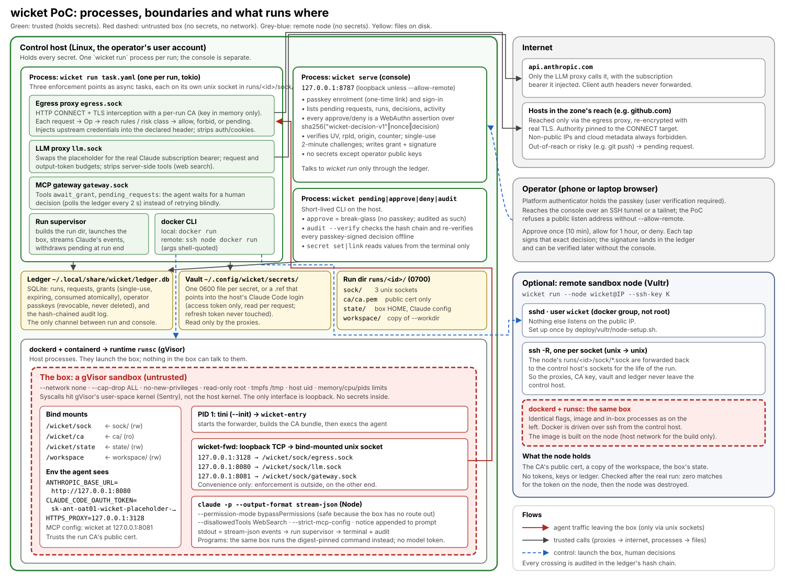

# wicket

wicket runs AI agents, Claude Code first, in sandboxes that have no network and hold no secrets. Every
request an agent makes leaves the box through wicket. wicket decides it against the agent's **zone**,
the hosts, methods and paths it may reach. Anything outside the zone waits for a human, who approves or
denies it with a passkey. wicket is a meta-harness: it doesn't run an agent loop of its own, it builds and
polices the environment the agent runs in.

- The agent runs in a **gVisor** box with `--network none`, a read-only root and no capabilities.
- The box reaches the world only through three proxies on the host: the **LLM proxy** (it holds your
  Claude subscription token, never an API key, and enforces the model budget), the **egress proxy** (it
  terminates TLS, decides each HTTP/1.1 or HTTP/3 request and injects credentials), and the
  **MCP gateway** (wicket's own tools for the agent).
- Every decision is in a hash-chained audit log that `wicket audit --verify` checks offline.

wicket 0.0.1 is the first release, for Linux. Read [docs/limits.md](docs/limits.md), "what wicket
doesn't protect", before you trust it with anything.

- Concepts: [docs/concepts.md](docs/concepts.md). Changes: [CHANGELOG.md](CHANGELOG.md).
- Reference: [agents](docs/agents.md) (identity, children, links, sessions, hibernation),
  [console](docs/console.md), [nodes](docs/nodes.md) (enrolment, `node serve`, placement, leases),
  [audit export](docs/audit-export.md), [performance](docs/performance.md).
- Design: [docs/design.md](docs/design.md), [research](docs/research/), [prior art](docs/prior-art.md),
  [test record](docs/poc-results.md).



## Install

A control host runs wicket as its own system user. `wicketd` (`wicket daemon`), the console and the
reconciler run as `wicket`, which owns the data in `/var/lib/wicket` (mode 0700: the ledger, vault, issuer
key, runs and their sockets) and is the only user in the `docker` group. Operators run the usual `wicket`
commands, which go to the daemon over `/run/wicket/wicketd.sock`.

On a fresh Ubuntu 24.04 or Debian 12 host:

```sh
curl -fsSLO https://github.com/public/wicket/releases/download/v0.0.1/wicket-0.0.1-x86_64-linux.tar.gz
curl -fsSLO https://github.com/public/wicket/releases/download/v0.0.1/wicket-0.0.1-x86_64-linux.tar.gz.sha256
sha256sum -c wicket-0.0.1-x86_64-linux.tar.gz.sha256 && tar xzf wicket-0.0.1-x86_64-linux.tar.gz
sudo wicket-0.0.1-x86_64-linux/deploy/install.sh        # --help for its options
sudo wicket secret set claude-oauth                      # the one secret: a token from `claude setup-token`
wicket doctor                                            # as yourself, after logging in again (new group)
sudo wicket operator enrol-link --origin http://localhost:8787   # a passkey for the console
```

From a checkout instead, run `cargo build --release -p wicket-cli` first, then `sudo deploy/install.sh`.

`deploy/install.sh` does the following, and is safe to run again:

- installs Docker and gVisor, and registers gVisor as `runsc` with `--host-uds=open`;
- creates the `wicket` user and the `wicket-operators` group. It adds you to the group and takes you
  out of `docker`, since Docker is root on the host;
- installs the binary, the daemon's policy (`/etc/wicket/wicketd.yaml`) and the console's options
  (`/etc/wicket/console.env`);
- installs and starts systemd units for `wicketd`, `wicket-console` and `wicket-reconcile`;
- sets up the identity issuer (`--trust-domain`) and builds the agent image.

`wicket doctor` checks all of it.

Who may do what:
- The daemon names each caller from the kernel (`SO_PEERCRED`), not from anything the caller says.
- The `wicket-operators` group may read state, start and steer runs, and revoke.
- **Approving, denying, secrets, passkey enrolment, nodes and spending need root** (`sudo wicket approve
  …`, the host break-glass) **or a passkey in the console**. So an agent session running as your own user
  can't approve anything.
- **Secrets are bound to hosts.** Whoever stores a secret names the only hosts it may go to:
  `sudo wicket secret set github-token --hosts api.github.com,github.com` (also on `secret link`; change it
  with `secret hosts NAME --hosts …`). A manifest that injects a secret elsewhere, or points `llm.upstream`
  at another host, is refused, and the proxies check again before sending. A secret bound to no hosts is
  sent nowhere; `claude-oauth` defaults to `api.anthropic.com`.
- Manifests and `--workdir` are sent to the daemon as content. Mounting a directory in place
  (`--workspace-dir`, `wicket wrap`) is root's only.
- Restarting `wicketd` stops the runs started through it.
- The console is the `wicket-console` unit, listening on 127.0.0.1:8787 by default. Its `wicket serve`
  options (for a public origin, TLS or ACME) go in `/etc/wicket/console.env`, and `wicket serve` itself is
  refused through the daemon.

The commands in the rest of this README are written for development mode. On an installed host, prefix the
privileged ones with `sudo`: `approve`, `deny`, `secret set|link`, `node …`, `place …`, `reconcile`, `reap`,
`image`, `identity init`, `secret hosts` and `operator enrol-link|reset|revoke-session`. The release archive
holds the binary, `deploy/` and `images/`, so the examples and the `docs/` pages are in the repository, not
the archive.

### Development mode

Without the daemon, `wicket` runs as your own user. `wicket doctor` reports this mode as insecure:
anything running as you can reach run sockets, read the ledger and approve. You need Linux with Docker
and gVisor registered with `--host-uds=open`:

```json
{ "runtimes": { "runsc": { "path": "/usr/bin/runsc", "runtimeArgs": ["--host-uds=open"] } } }
```

```sh
cargo build --release -p wicket-cli && export PATH=$PWD/target/release:$PATH
wicket image                                            # builds wicket/claude-code:poc
wicket identity init --trust-domain wicket.example.com  # once per installation
# The model credential: reference this host's Claude Code login (re-read at each use, never copied)...
wicket secret link claude-oauth --file ~/.claude/.credentials.json \
    --pointer /claudeAiOauth/accessToken --expires-pointer /claudeAiOauth/expiresAt
# ...or store a token from `claude setup-token`:   wicket secret set claude-oauth
wicket doctor
```

## First run

From a checkout (or with `examples/hello-github.yaml` downloaded from the repository):

```sh
wicket run examples/hello-github.yaml   # an agent reads a public repo, then asks for example.com
wicket pending                          # in another terminal, while the run waits
wicket approve r-xxxxxxxx               # or: wicket deny r-xxxxxxxx
wicket audit --tail 20
```

For a run without a model, `examples/mock-github.yaml` with `wicket dev mock-llm --command '…'` drives the
whole path with a scripted model (store its stand-in secret with `wicket secret set mock --hosts 127.0.0.1`).

## Features

### Zones

A zone says what a box may reach without asking. Everything else becomes a pending request, or is
refused outright by `forbid`, or doesn't exist for the box (`unlisted_hosts: hide`).

```yaml
zone:
  name: research
  isolation: gvisor
  reach:
    - { host: api.github.com, paths: ["/repos/octocat/Hello-World", "/repos/octocat/Hello-World/**"] }
  forbid:
    - { host: api.github.com, paths: ["/repos/octocat/Hello-World/actions/**"] }
  inject:                       # the credential goes in this one header, toward this one host
    - { host: api.github.com, header: Authorization, format: "Bearer {secret}", secret: github-ro }
                                # stored with: wicket secret set github-ro --hosts api.github.com
  llm: { secret: claude-oauth, max_requests: 60, max_output_tokens: 60000 }
  limits: { memory: 2g, cpus: 1, timeout: 15m }
```

Agents ask ahead with the `request_access` tool, and wait for an answer with `await_grant` instead of
retrying.

### Spawn

With `agent.max_children` set, an agent can start a child agent or a program, each in its own box and
with its own identity, in a zone the agent writes. The zone must be a subset of the agent's own: reach,
credentials, model budget (carved out), resources, time, isolation and images. Otherwise `spawn` lists
what exceeds it, and with `ask_human: true` puts exactly that zone to a human.

```json
{"name": "fetcher", "task": "Summarise the README", "zone": {"reach": [{"host": "api.github.com", "paths": ["/repos/octocat/Hello-World/readme"]}]}}
```

### Approvals and the console

`wicket serve` is the operator console: what's waiting, runs, decisions and activity. It signs you in with
a passkey, and **every approve or deny is signed again** over exactly that decision, so `wicket audit
--verify` re-checks each one offline. From the console you can also start runs from allowlisted
manifests, send follow-ups and revoke identities. It is built to face the internet (TLS from files or
ACME, rate limits, strict headers):

```sh
wicket serve                                            # http://localhost:8787
wicket serve --listen 0.0.0.0:443 --acme-domain console.example.com --acme-agree-tos \
    --acme-contact mailto:ops@example.com
```

Grants are single-use and expire after 10 minutes unless you say otherwise
(`wicket approve ID --uses 3 --ttl 1h`, or `--prefix` for a path prefix). See [docs/console.md](docs/console.md).

### Nodes: enrol, serve, placement

`wicket run --node <name>` runs the box on another machine. Enrolling pins the node's ssh host key and
gives it its own key and a short-lived node CA, name-constrained to `--hosts`. `wicket node install`
starts `wicket node serve` there. The node then runs the box and decides its egress from a signed policy
feed, so the box keeps working, failing narrow, while the control host is unreachable.

```sh
wicket node token --name n1 --ttl 1h
wicket node enrol wicket@203.0.113.7 --token wkt_… --host-key 'SHA256:…' --hosts 'api.example.com'
wicket node install n1
wicket run task.yaml --node n1
```

`wicket place` provisions nodes on Vultr inside a money envelope, with each create confirmed on the
terminal. Agents ask for a machine with the `request_capacity` tool, a human approves the lease, and
`wicket reconcile --every 30s` provisions it and destroys it at the lease's end:

```sh
wicket secret set vultr-api-key
wicket place create --name n2 --region lhr --vcpus 1 --memory-mib 2048 --lifetime 1h \
    --max-hourly 0.05 --max-total 0.50 --ssh-key-id <id> --ssh-key <private key> --hosts 'api.example.com'
wicket place release <instance-id>
```

See [docs/nodes.md](docs/nodes.md).

### Links

Boxes still have no network, but they can reach each other's ports through links that wicket relays.
`expose(port)` offers a port, `connect(box, port)` returns `<name>.wicket.internal:<port>` in the caller's
box, and `link(from, to, port)` wires two boxes the caller controls. A box's own children are connectable
without `expose`; anyone else needs the target's `expose` and `accept_from`, or a human. Every link is
audited and can be cut:

```sh
wicket links
wicket unlink l-xxxxxxxx
```

`examples/links/demo.sh` runs the whole thing with the mock model.

### Hibernate

Every Claude Code agent is long-lived: an id, a session and a generation. Set `agent.idle_timeout` to keep
it between turns, and `agent.hibernate_after` to hibernate it. Its box stops and its whole writable state
is bundled: the workspace, `$HOME`, `/tmp` and `persist: durable` volumes. A follow-up or a message from
another agent rebuilds the box and resumes the session. Budgets span the agent's whole life.

```yaml
agent: { name: helper, idle_timeout: 10m, hibernate_after: 1h }
```

```sh
wicket agents
wicket hibernate <run>
wicket say <agent> "and now the tests"     # wakes it if it is hibernated
```

### HTTP/3

The box resolves names through wicket's DNS. Each reachable host gets a synthetic address in
198.19.0.0/16; hidden and forbidden hosts get NXDOMAIN, so a lookup can't carry data out. QUIC to those
addresses is relayed to wicket, which terminates it with the run's CA and decides each request exactly
like an HTTP/1.1 one. 0-RTT is refused. Under gVisor, HTTP/3 downloads run at 40–100 Mbit/s;
`WICKET_H3_BOX_MTU=16000` raises that for clients that accept large packets. Nothing to configure:
rebuild the image with `wicket image`.

### Audit export

The audit log can be streamed to JSON lines files or an OpenTelemetry Collector, with signed checkpoints of
the chain head. Put the sinks in `$WICKET_HOME/audit-sinks.yaml`:

```yaml
checkpoint_every: 5m
sinks:
  - { name: local-file, type: jsonl, path: /var/log/wicket/audit.jsonl }
  - { name: collector, type: otlp, endpoint: http://127.0.0.1:4318 }
```

```sh
wicket audit export --status
wicket audit --verify --against /var/log/wicket/audit.jsonl
```

See [docs/audit-export.md](docs/audit-export.md).

### Also

- **Programs:** deterministic workloads with no model, pinned by source digest (`wicket program digest
  DIR`); `examples/program-repo-stats.yaml`.
- **Remote Control in a box:** `wicket wrap --manifest <m> -- <command>` runs an agent another program
  launches; `examples/remote-control/`.
- **Volumes, follow-ups and in-place workspaces:** `zone.volumes`, `wicket say`, `--workspace-dir`;
  `examples/self-hosting/` runs an agent on wicket's own source.
- **Crash cleanup:** `wicket reconcile` (or `wicket reap`) stops boxes whose `wicket run` died.

## Acceptance test

`ci/acceptance.sh` runs the main flows against the real image, gVisor and Docker, with the scripted mock
model (no model credential), checks each outcome, prints a summary and tears everything down, on failure too:
an agent's egress (HTTP/1.1 and HTTP/3, in reach and out of it), one request approved and one denied, `spawn`
of a narrower zone and of a wider one with `ask_human`, a `link` between two boxes and a fetch across it,
revoking the agent and its whole subtree, hibernate and wake, an orphaned box stopped by `wicket reconcile`,
and `wicket audit --verify`, with an export to a JSON-lines sink checked by `--against`.

```sh
ci/acceptance.sh                    # development mode: this checkout's binary, fresh data, boxes named acc-*
ci/acceptance.sh --nodes local      # and the multi-host flow: a capacity lease on localhost as a node
                                    # (the static backend), a box there, ci/node-e2e.sh, revoke, reconcile
ci/acceptance.sh --installed        # as an operator, against an installed system (wicketd, sudo wicket)
ci/install-acceptance.sh            # --installed against deploy/install.sh in a fresh container
ACC_VULTR=yes ci/acceptance.sh --nodes vultr   # a fresh Vultr node (spends money; see the script's header)
```

Links between a box on a
node and one on the control host aren't supported yet; the multi-host flow records that and runs the node
e2e flow instead.

## License

See [LICENSE](LICENSE).
