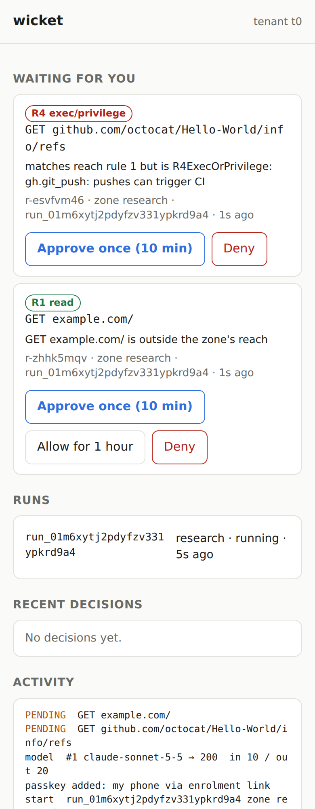

# wicket

A Rust meta-harness: it builds least-privilege environments for other agent processes (Claude Code first,
any agent in principle), brokers every boundary crossing (model API, HTTP egress, git, MCP tools) from
outside the sandbox, and shows humans the boundaries as zones and gates.

- Concepts (canonical): Claude Doc "wicket — core concepts"; pointer in [docs/concepts.md](docs/concepts.md).
- Detailed design: [docs/design.md](docs/design.md). Research notes: [docs/research/](docs/research/).
  Prior art: [docs/prior-art.md](docs/prior-art.md).

## Proof of concept

The PoC is a vertical slice of milestones M0 and M1: one Claude Code agent, one zone, one sandbox, single tenant
(`t0`, with tenant ids carried everywhere so platform mode can be added).


What it does:
- runs Claude Code in a **gVisor** container with **no network** (`--network none`, read-only root, all
  capabilities dropped);
- the box's only way out is two unix sockets bind-mounted in: the **LLM proxy** (holds the Claude subscription
  token, strips the agent's placeholder, enforces request and token budgets, strips server-side tools; wicket never
  uses Anthropic API keys) and the **egress proxy**
  (per-run CA, TLS interception, canonicalize-or-reject, reach rules, a GitHub dangerous-pattern list, credential
  injection into one declared header slot);
- a minimal **MCP gateway** is the agent's only MCP server; its `await_grant` tool lets a blocked agent wait for
  the human's decision instead of sleeping and retrying;
- requests outside the zone's reach become **pending escalations** (HTTP 403 problem+json with a request id); a
  human approves or denies them with `wicket approve` / `wicket deny`, and the grant is single-use and expiring by
  default, recorded in a SQLite ledger;
- every decision goes into a **hash-chained audit log** (`wicket audit --verify`).

#### Agent identity and child agents

Every agent run gets an identity issued by the installation (`spiffe://wicket.local/t/<tenant>/z/<zone>/a/<agent>`),
an EdDSA-signed document whose key is held by wicket, never by the box.

- Show it: `wicket identity issuer` (public key for verifiers), `wicket identity list`, `wicket identity show <run>`.
- Pending requests show the requesting agent's verified identity. The console won't approve for an agent
  whose identity doesn't verify.
- Agents talk only through wicket: `send_message` and `await_message` in the gateway. wicket sets and signs the
  sender. Parent and child may always talk; other zones only if the recipient's zone lists them in
  `accept_from`.
- `max_children: N` in the agent spec allows `spawn_agent`: a child agent in its own sandbox with its own identity,
  whose requests are approved separately. Set `in_box_subagents: false` to make that the only kind of subagent.
- Identities are short-lived: valid 10 minutes, re-issued every 5 with a fresh key (`WICKET_IDENTITY_TTL` to change).
  `wicket identity revoke <run>` stops the run's box and everything it started, and refuses its messages
  and approvals.
- Every identity records who it acts for, back to the human: `acting for: alice (cli, unix-user) → lead → fetcher`.
- `wicket audit --verify` re-checks every identity ever issued (rotations included) and every message signature,
  offline.

## Requirements

Linux with Docker and gVisor (`runsc`) registered as a Docker runtime with `--host-uds=open`:

```json
{ "runtimes": { "runsc": { "path": "/usr/bin/runsc", "runtimeArgs": ["--host-uds=open"] } } }
```

Rust (stable) to build.

### Quick start

```sh
cargo build --release -p wicket-cli
./target/release/wicket image              # builds wicket/claude-code:poc
# the model credential is your Claude subscription (never an API key). Either reference the login already on this host
# (read at each use, never copied, refresh untouched):
./target/release/wicket secret link claude-oauth --file ~/.claude/.credentials.json \
    --pointer /claudeAiOauth/accessToken --expires-pointer /claudeAiOauth/expiresAt
# ...or store a long-lived token from `claude setup-token`:  ./target/release/wicket secret set claude-oauth
./target/release/wicket doctor
./target/release/wicket run examples/hello-github.yaml
# in another terminal, while the run waits:
./target/release/wicket pending
./target/release/wicket approve r-xxxxxxxx      # or: wicket deny r-xxxxxxxx
./target/release/wicket audit --tail 20
./target/release/wicket serve              # operator console on 127.0.0.1:8787; prints a one-time sign-in link
```

The console (`wicket serve`) shows what's waiting for you, runs, recent decisions and activity, and you approve
or deny from a browser or phone. It uses **passkeys**:
- the first passkey is enrolled through a one-time link printed at start-up (single use, 10 minutes, valid only
  while no passkey exists, and it can do nothing but enrol);
- sign-in is a passkey with user verification;
- **every approve or deny is signed again**, over a challenge that is the hash of exactly that decision
  (request, method, host, path, decision, uses, lifetime). The server checks it, uses it once, and stores the
  signed record, so `wicket audit --verify` re-verifies every decision offline;
- `wicket operator reset` (host only) revokes passkeys but keeps their public keys for verification.

Open it as `http://localhost:8787` (WebAuthn needs a secure context). `wicket approve` on the host remains a
break-glass path and is audited as such.



**Programs** (deterministic workloads, no model): `examples/program-repo-stats.yaml` runs a script in the same
sandbox with the same egress control. Pin the approved source with `digest:` (from `wicket program digest DIR`), and
any change is refused until re-approved. Out-of-reach requests fail instead of escalating (`on_pending: fail`).

For testing without a model, `examples/mock-github.yaml` plus `wicket dev mock-llm --command '...'` drives the whole path
with a scripted model.

### Not in the PoC yet

Adapter-generated MCP tools and third-party MCP servers, multiple zones and gates, labels and handles, the console and passkey approvals, long-lived agents
and hibernation, Cedar policy, multi-tenant mode, other agents (Codex, pi). Response bodies are not scrubbed for
reflected credentials (headers are). See the milestones in docs/design.md.
