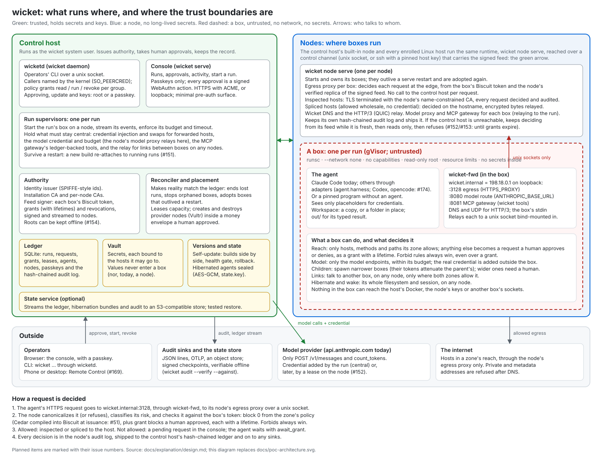

# wicket

wicket runs AI agents, Claude Code first, in sandboxes that have no network and hold no secrets. Every
request an agent makes leaves the box through wicket. wicket decides it against the agent's **zone**,
the hosts, methods and paths it may reach. Anything outside the zone waits for a human, who approves or
denies it with a passkey. wicket is a meta-harness: it doesn't run an agent loop of its own, it builds and
polices the environment the agent runs in.

- The agent runs in a **gVisor** box with `--network none`, a read-only root and no capabilities.
- The box reaches the world only through three proxies: the **model proxy** (it holds your Claude
  subscription token, never an API key, and enforces the model budget), the **egress proxy** (it
  terminates TLS, decides each HTTP/1.1 or HTTP/3 request and injects credentials), and the
  **MCP gateway** (wicket's own tools for the agent).
- Every decision is in a hash-chained audit log that `wicket audit --verify` checks offline.

wicket 0.0.1 is the first release, for Linux. Read [what wicket doesn't protect](docs/explanation/limits.md)
before you trust it with anything.



## Quick start

On a fresh Ubuntu 24.04 or Debian 12 host, from the [v0.0.1 release](https://github.com/public/wicket/releases/tag/v0.0.1):

```sh
tar xzf wicket-0.0.1-x86_64-linux.tar.gz && cd wicket-0.0.1-x86_64-linux
sudo deploy/install.sh                    # Docker, gVisor, the wicket user, wicketd, the console
sudo wicket secret set claude-oauth       # the one secret: a token from `claude setup-token`
wicket run examples/hello-github.yaml     # after logging in again; it asks for example.com...
sudo wicket approve r-xxxxxxxx            # ...which you approve here, or in the console
```

[Install on a host](docs/how-to/install-on-a-host.md) has every step, including checking the
download and enrolling a passkey for the console.

## Documentation

- **[Tutorials](docs/README.md#tutorials)**: [your first box](docs/tutorials/first-box.md), and
  [approvals, children and links](docs/tutorials/approvals-children-and-links.md).
- **[How-to guides](docs/README.md#how-to-guides)**: install, the console on the internet, zones,
  secrets, nodes and Vultr, hibernation, audit export, state off the host, updates, and more.
- **[Reference](docs/README.md#reference)**: the [command line](docs/reference/cli.md), the
  [manifest](docs/reference/manifest.md), the [MCP tools](docs/reference/mcp-tools.md), files,
  configuration and the protocol.
- **[Explanation](docs/README.md#explanation)**: [concepts](docs/explanation/concepts.md), the
  [security model](docs/explanation/security-model.md), [design](docs/explanation/design.md) and
  [research](docs/explanation/research/).

Changes: [CHANGELOG.md](CHANGELOG.md).

## License

See [LICENSE](LICENSE).
