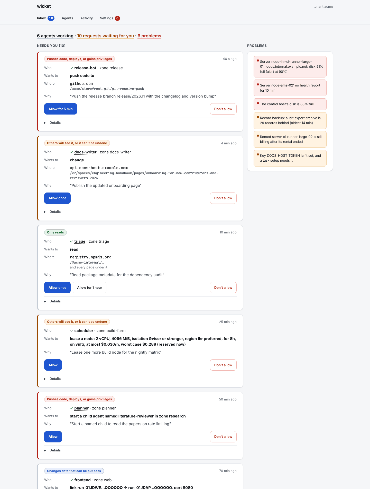
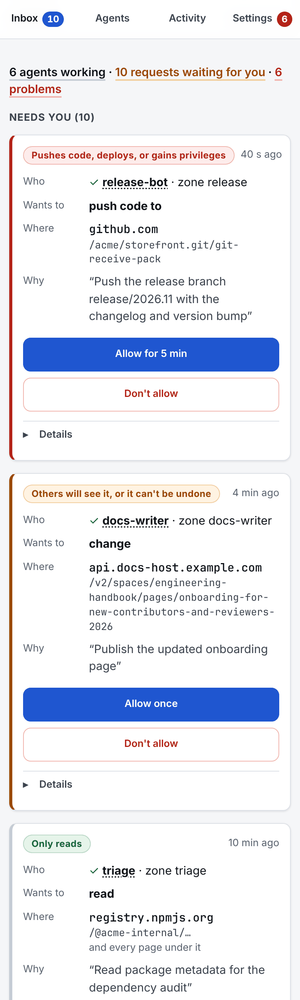
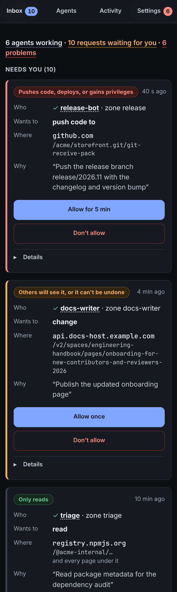
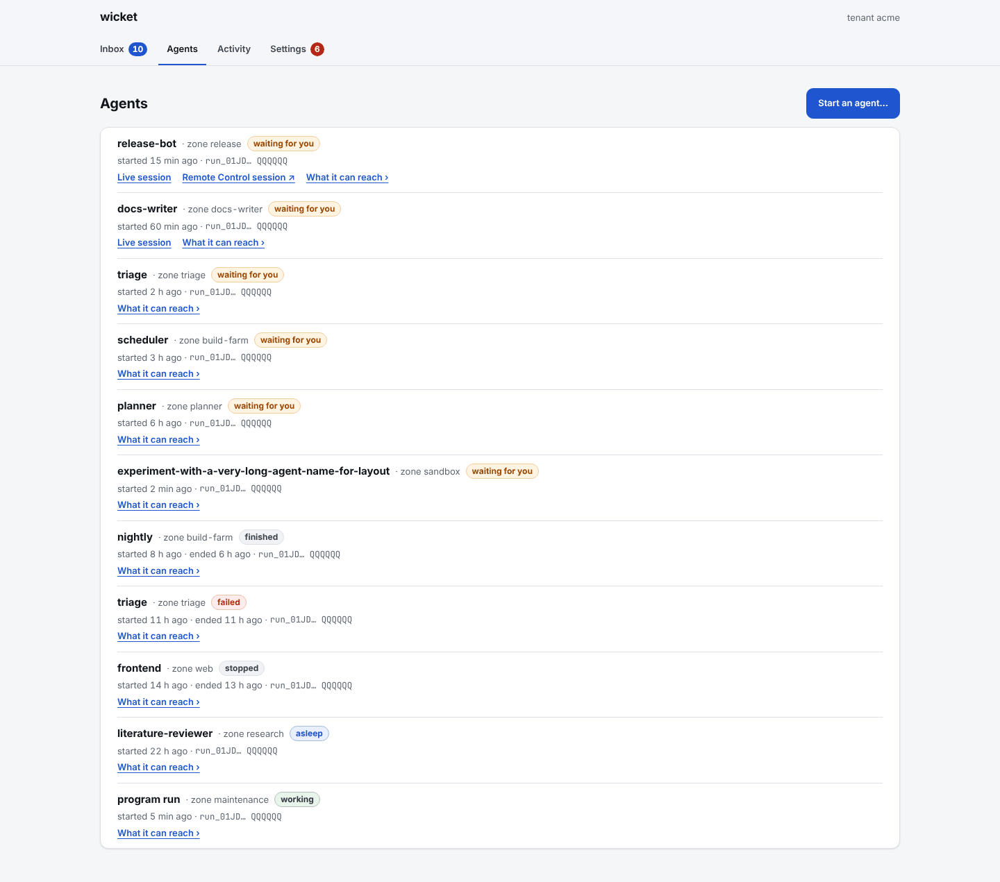
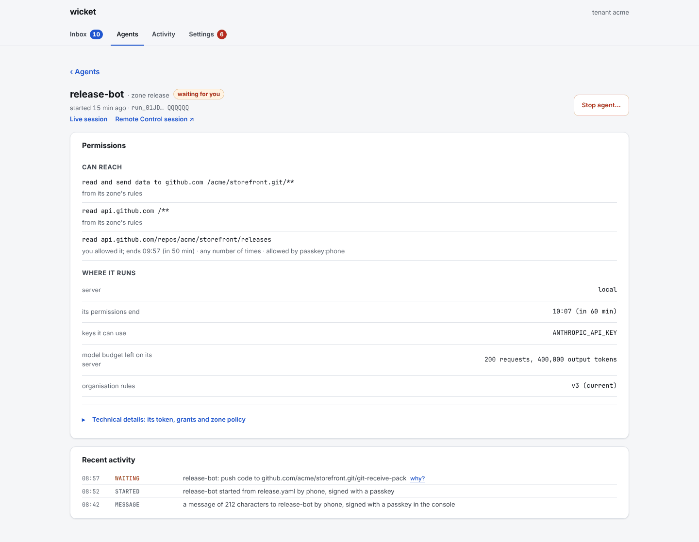
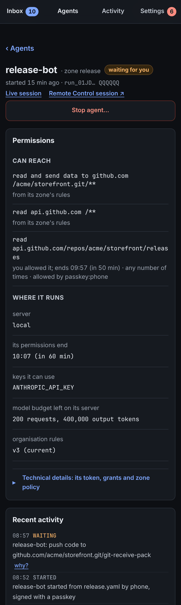
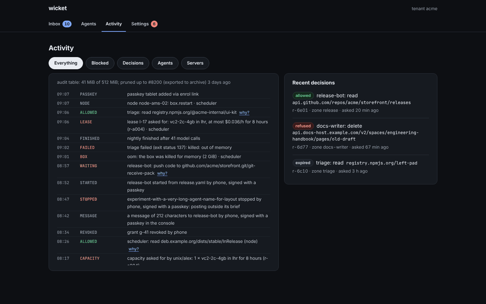
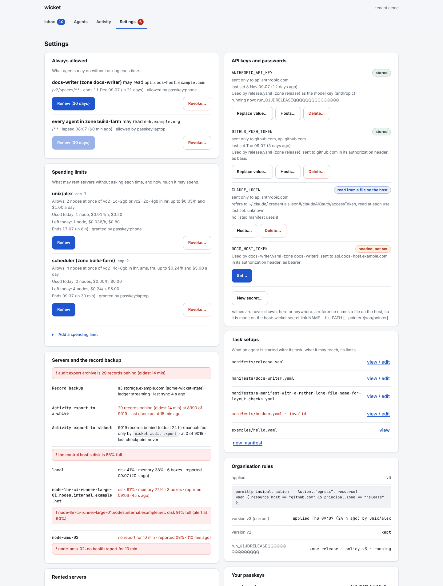
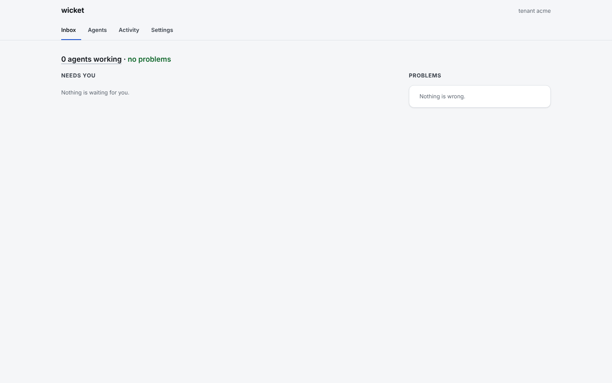

# The console's design

What the console is for, who uses it and how, and the decisions its layout and words follow. Read this
before changing the console (`crates/wicket-cli/src/serve/static`). `ci/console-preview.sh` shows the
page against made-up data.

## Who uses it, and where

An operator who runs agents with wicket. They have basic technical skill (they know what an HTTP
request, a git push or an API key is), but they shouldn't need wicket's internals to use the console.
They use it equally:

- **on a phone**, opened from a notification, to decide a request in seconds; and
- **on a desktop**, kept open, to watch agents work, dig into a problem, or set things up.

## The jobs

Most frequent and most urgent first. Each job names the screen that serves it.

1. **"Something is asking me. Should I let it?"** An agent wants to reach a host, push code, start a
   child agent, rent a server or install a build. The operator needs four things: who asks, what
   exactly it will do, why, and what could go wrong. Then they choose how far to trust it: once, for
   an hour, always, or not at all. *Inbox.*
2. **"Is everything all right?"** Are my agents working, waiting, finished or failed? Is a server
   down or full, is the backup behind, is money being spent? This needs one glance, not a scan of
   fourteen sections. *Inbox status line and Problems; the Agents list.*
3. **"What is this agent doing, and what can it do?"** What it is working on, what it can reach right
   now and until when, what it did recently. From there: open its live session, or stop it.
   *An agent's page.*
4. **"Start some work."** Pick a task setup (a manifest), optionally give it different
   instructions, and start it. *Agents → Start.*
5. **"Stop something going wrong."** Stop an agent, remove a permission it was given, or cut a
   spending limit. Each must be easy to find and hard to hit by accident. *An agent's page; Settings.*
6. **"Why did that happen?"** Why was a request blocked or allowed? What did an agent do at 03:00?
   *Activity, with an explanation per line.*
7. **"Set things up."** Rarely: API keys and passwords, spending limits, permanent permissions,
   notification devices, passkeys, task setups and organisation rules. *Settings.*

Jobs 1 and 2 are why most people open the console. They come first and need no scrolling. Jobs 6
and 7 can take two taps.

## Structure: an inbox and three tabs

```
Inbox (n) · Agents · Activity · Settings
```

- **Inbox**, the home screen:
  - **Status line**: "4 agents working · 1 waiting for you · 1 problem", each part a link.
  - **Needs you**: every request, one card each, oldest first. An agent's ask to be *always* allowed
    something is a request too, in the same list, with Always already chosen and its evidence shown.
  - **Problems**: health alerts in plain words, each with what to do ("Server ams-2 hasn't reported
    for 10 min", "Rented server ci-runner-02 is still billing: release it with `…`").
  - When nothing waits and nothing is wrong: "All clear", and the status line.
- **Agents**: a list (working, waiting, then finished and failed), each row showing the agent's name,
  its state in words and how long. A row opens **the agent's page**:
  - what it is doing and on which server;
  - **Can reach**: its zone's rules, what it was allowed and until when, and its always-allowed rules;
  - **Recent activity**;
  - **Live session**, **Remote Control session ↗** and **Stop agent…**;
  - its ids under Details.

  **Start…** opens the task setups.
- **Activity**: one sentence per event, newest first, filterable by "blocked", "decisions",
  "agents" and "servers". Each blocked or allowed request can be explained.
- **Settings**: Always allowed · Spending limits · Rented servers · API keys and passwords · Task
  setups · Organisation rules · Notifications · Passkeys and devices. The health of servers and of
  the record backup (state store) is here in full; the Inbox shows only what is wrong.

On a desktop the tabs are a top bar, and Inbox puts Needs you and Problems side by side when there
is room. On a phone the tabs are a bottom bar within reach of the thumb, and the waiting count is on
the Inbox tab, the page title and the app badge.

## A request card: labelled fields

```
Who       triage · zone triage                         4 min ago
Wants to  read
Where     registry.npmjs.org /@acme-internal/…  (and every page under it)
Why       "Read package metadata for the dependency audit"
Risk      ● Only reads

Allow:  [ Once ]  [ For 1 hour ]  [ Always… ]      [ Don't allow ]
▸ Details
```

- **Wants to** is the action in a verb, from the method and path:
  - GET and HEAD: read;
  - POST: send to;
  - PUT and PATCH: change;
  - DELETE: delete;
  - git's `git-receive-pack`: push code to; `git-upload-pack`: fetch code from;
  - wicket's own kinds: rent a server, start a child agent, connect two agents, install a wicket
    build.

  The exact request (`PUT api.docs-host…/v2/…`) is under Details, never hidden.
- **Where** is the host name, then the path in a quieter style, wrapped at its slashes.
- **Why** is the agent's own reason, in quotes, because the agent wrote it.
- **Risk** says what could happen, not a code:

  | Risk class | Says |
  |---|---|
  | R0 and R1 | Only reads |
  | R2 | Changes data that can be put back |
  | R3 | Others will see it, or it can't be undone |
  | R4 | Pushes code, deploys, or gains privileges |

- **The ladder**: Once, For 1 hour, Always…, Don't allow. Steps that don't apply are left out: a git
  push is one window of a few minutes; R3 and R4 are one use at a time; wicket's own kinds are one
  decision. **Always…** opens the choice of for this agent or for every agent in its zone, for 30
  days, and when it narrows to what the agent actually used, it says so and makes that the default.
  An agent's "always" ask arrives with Always chosen and its evidence ("asked 37 times in 6 days, you
  allowed 35").
- **Details**: on whose behalf the agent acts, which part of the agent asked (as it reports it), the
  exact request, the request and run ids, and how the grant is made.
- An agent whose identity doesn't check out: the card says "We can't confirm this is release-bot"
  and offers only Don't allow.

The signing sheet that opens on a choice says the same thing the card does, in the same words. Under
it, unchanged, are what the passkey signs: the effect the server sent and its hash.

## Words

Everyday words on the screen; wicket's terms (which the CLI and the docs use) under Details, so an
operator can match the two.

| On screen | wicket's term |
|---|---|
| agent (its name), or "agent run" where the instance matters | run, workload, principal |
| zone (with its name; explained once: "the rules this agent was started with") | zone |
| server | node |
| request, Allow and Don't allow | request, approve and deny, grant |
| Always allowed | standing reach, standing rule |
| spending limit ("may rent up to 2 servers, $1.00 a day") | capacity grant |
| rented server; "rented until 14:30" | placed node, lease |
| task setup | manifest |
| API keys and passwords | secrets, vault; references |
| checked; passed through unread | inspected; spliced |
| record backup | state store |
| activity log export | audit export, sink, checkpoint |
| organisation rules | org policy (Cedar) |
| signed with your passkey | passkey-signed action |
| you (phone), or another operator's passkey name | `passkey:phone`, operator principal |
| ids such as `r-7f3a` and `run_01JD…` | under Details only, cut in the middle, copied whole |

## The visual system

The first console refinement (#698) set this up, and it stays:

- tokens for spacing (4 px steps), type (12/13/15/17/20) and colour per theme, with all text at
  least 5.2:1;
- one card, one button height (44 px), and pills for state;
- alerts as tinted panels;
- `prefers-reduced-motion`, focus outlines everywhere, and safe areas on a phone.

## What doesn't change

- What an approval binds to and the effect it shows: the effect and its hash are exactly what the
  server sends. Only their presentation changes.
- Every decision is still the server's signed action; the console only presents it.
- No inline script or style (the CSP), and no external fonts or assets.

## Open

- **The signing sheet** still says the action in wicket's words ("Approve any number of uses for 5
  min", the agent's SPIFFE id, the run id). It will use the card's fields and words, with the
  effect's hash and the ids under them. It is next, as its own change, because it is the text shown
  at the moment of signing.
- **Always… on any request.** The server has no signed action that turns a one-off request into a
  standing rule: "always" exists only when an agent asks for it (`standing_approve`). Offering it on
  every card needs that action first.

## Screens

Made-up data from `ci/console-preview.sh`.

| | |
|---|---|
| Inbox (desktop) |  |
| Inbox (phone, light and dark) |   |
| Agents, and an agent's page |    |
| Activity (dark) |  |
| Settings |  |
| Nothing waiting |  |
