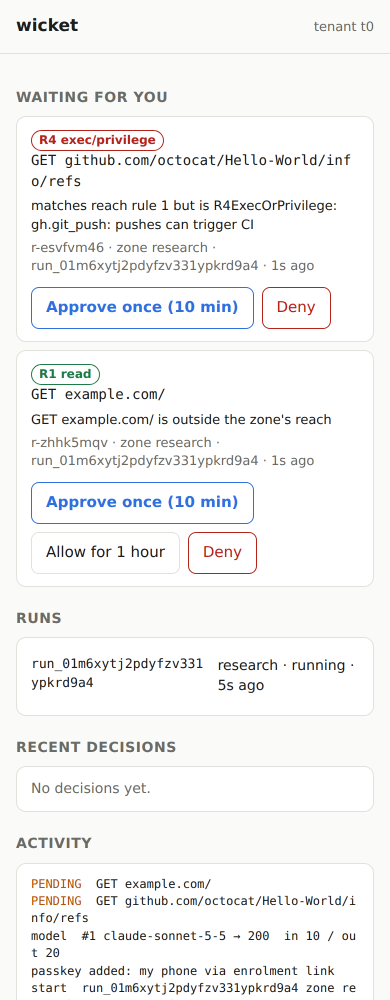

# The operator console

The console (`wicket serve`) shows what's waiting for you, runs, recent decisions and activity, and you approve
or deny from a browser or phone. Its options are in the [command line reference](cli.md#wicket-serve); [put the console on the
internet](../how-to/put-the-console-on-the-internet.md) sets it up behind TLS.

## Passkeys

It uses **passkeys**:
- passkeys are enrolled only through one-time links from the host: `wicket serve` prints one at start-up while no
  passkey exists, and `wicket operator enrol-link [--ttl 10m] [--origin URL]` prints a fresh one at any time
  (single use, 10 minutes by default and at most 1 hour; the session it opens can only enrol one passkey).
  An installed console runs with `--no-bootstrap-link`, so there you use `sudo wicket operator enrol-link`. A
  signed-in console session can't add a passkey, so a stolen cookie can't either;
- sign-in is a passkey with user verification;
- **every approve or deny is signed again**, over a challenge that is the hash of exactly that decision
  (request, method, host, path, decision, uses, lifetime). The server checks it, uses it once, and stores the
  signed record, so `wicket audit --verify` re-verifies every decision offline;
- **signing takes two steps.** A tap on Approve, Deny, Send, Revoke or Start asks the server for the exact
  action. The page then shows that action in a confirmation pinned to the top of the screen, above where a
  phone's passkey sheet opens, and only its own button starts the passkey ceremony. The authenticator's sheet
  shows only the site's name, so this confirmation is what tells you what you're signing. While it is open,
  nothing on the page is redrawn. Pending cards are kept by request id, and a tap within a moment of the cards
  moving is ignored, so an agent can't slide another request under your finger;
- `wicket operator reset` (host only) revokes passkeys but keeps their public keys for verification.

## Actions

Signed in, the console can also do what was CLI-only, each action signed with a fresh passkey assertion over
exactly its parameters, checked again when applied, audited with the passkey that signed it and re-verified by
`wicket audit --verify`:
- **start a run** from a manifest in an allowlisted directory, with an optional task override. The directories are
  the installation's `manifests/` (`$WICKET_HOME/manifests`, by default `~/.local/share/wicket/manifests`) and
  `examples/` of the directory `wicket serve` was started in. The browser picks a directory and a file name from
  the list the server offers (regular files named `*.yaml`/`*.yml` directly in them; no symlinks, subdirectories
  or paths), and the passkey signs the manifest's SHA-256, so a file changed after you saw it is not started. The
  start card shows, and the passkey signs, the image the box starts from: the manifest's `agent.image` (default:
  the installation's agent image); a manifest whose image isn't in its `zone.images` is refused. The run is a detached `wicket run` (it outlives the console; its log is `runs/<run>/console.log`), and its principal
  is you, the passkey-signed-in operator (`passkey:<name>, via console`), not the host's unix user;
- **send a follow-up** to a running agent (`wicket say`);
- **revoke an identity** with a reason (`wicket identity revoke`);
- **answer `request_access` asks**, including prefix asks: the passkey signs that the grant covers every path
  under the prefix, and, as for every approval, the agent's verified identity. A prefix covers whole path
  segments (`/repos/acme/app/…` covers `/repos/acme/app` and what's under it, not `/repos/acme/app-secrets`),
  and every grant covers nothing riskier than the request you were shown: approving an R2 prefix doesn't
  allow the R4 operations (workflow edits, merges, access changes) under it. An agent whose identity
  doesn't verify (or was revoked since you were shown the ask) can be denied, not approved.

Open it as `http://localhost:8787` (WebAuthn needs a secure context). `wicket approve` on the host remains a
break-glass path and is audited as such.

## Authority views

Read-only, behind the session like the rest of the page (#173). Nothing here changes authority:
that stays a signed action.

- **A run's authority** (its row's *authority* link; `GET /api/runs/<run>/authority`): its token as
  its node's feed holds it now, read from the feed's delta log without writing anything.
  - Every block decoded to Datalog: block 0 (the zone's policy compiled, the org layer, the box's
    lifetime), each spawn block (the chain back to its root run), and each grant block, with the
    public key of whoever signed it.
  - Whether each block is revoked, with a **fingerprint** of its revocation id. In Biscuit a
    revocation id is the block's signature, so the id itself is never shown.
  - Each grant: what it allows, its uses (counted on the node) and expiry, who approved it (passkey
    or root) and when, whether it was revoked, and whether its node has the feed delta that carries it.
  - The policy version it was minted under, against the installed one; its deadline (when its
    authority ends) and whether its box stopped; which node holds it and its feed's epoch.
  - What its node holds for it (#152): the secrets it fetched, **by name only**, and its budget
    slice.
  - The zone's policy as Cedar, generated from the manifest.
  - Whether the token loads (it may not, for instance once its issuing key's certificate ended).
  An ended run's token is gone from its node's feed; its page says so.
- **Explain a decision** (an activity row's *explain* link; `GET /api/explain/<seq>`): the request
  that row records, as it was decided then (by whom, the control host or the box's node, and the
  detail recorded), and the run's token's decision for it **as the token is now**: the ceilings,
  the grant that allows it, or the failed checks, each naming its block. Grants and policy may have
  changed since; the page says so. Explaining spends no grant use and asks no node.
- **The org policy** (the *Policy* section; `GET /api/policy`): the applied Cedar and its entities,
  whether `org.cedar` still matches what was applied (a hand edit refuses every mint), every kept
  version with when and by whom it was applied, and each running run with the version it was minted
  under: current, older, or revoked by a later `wicket policy apply`.

**Never shown:** a serialized token, any signature (a block's or a JWS's), a secret's value, a private
key. Each view is built from named fields, never by serializing a stored record, and a test fetches
every console endpoint and scans each answer for the token, any 24-byte run of its bytes (base64url,
base64 and hex, except runs inside a public key), identity JWSs and private keys.

## On the internet

The console is built to be reachable directly from the internet, with no VPN or access proxy in front
(#23). Passkeys stay the only authentication. This is what it enforces; the setup is in [put the
console on the internet](../how-to/put-the-console-on-the-internet.md).

- **Client addresses.** `X-Forwarded-For` is read only on connections from a `--trusted-proxy`. All
  of its header lines are read, in order, and the client is the right-most entry that isn't a
  trusted proxy. Anything further left is whatever the client sent.
- **Transport.** A non-loopback listener refuses to start in plain HTTP unless `--behind-tls-terminator` is given
  with an `https://` `--origin`. TLS is rustls: TLS 1.3, and TLS 1.2 with ECDHE and AEAD suites only; HTTP/1.1
  only (no h2, so there is one HTTP implementation to bound). HTTPS responses carry
  `Strict-Transport-Security: max-age=63072000; includeSubDomains; preload` (submitting the domain to the
  preload list is your step). ACME keeps its account and certificate in `$WICKET_HOME/acme` (0700/0600) and
  renews 30 days before expiry; binding :443 needs `CAP_NET_BIND_SERVICE` (or a port redirect).
- **Before sign-in** a client can fetch only the page, its static files (script, stylesheet, manifest, icons)
  and the passkey sign-in endpoints. Everything else, whatever the method or path, gets the same 401 and body:
  no runs, counts, passkey ids or version. Enrolment is only via a one-time link issued on the host (`wicket operator enrol-link`).
- **Sign-in** needs user verification; there is no password or fallback. Attempts are limited per client
  address (IPv4, or IPv6 /64; `X-Forwarded-For` is honoured only from a `--trusted-proxy`) and per passkey:
  20 a minute, and 5 failures lock out for 15 minutes, doubling up to a day. Pending challenges expire after 2
  minutes and come from two bounded pools. Sign-in challenges get 512 in all, 8 per client and 32 per
  IPv4 /24 or IPv6 /48. Signed-in sessions' action and enrolment challenges get 512 in all and 8 per
  session. A flood of sign-in attempts therefore never stops the operator from approving. Every failure looks the same to the client, and every failure
  and lockout is in the audit log. The limiter remembers 4096 clients. When every entry is a live lockout, the
  oldest one is dropped to make room, so new clients aren't all refused.
- **Sessions** are `__Host-wicket_sid` cookies (Secure, HttpOnly, SameSite=Strict, Path=/), new at every
  sign-in, ending after 15 minutes idle or 8 hours in any case. `wicket operator sessions` lists them on the
  host and `wicket operator revoke-session ID` (or `--all`) ends them. Every action is still separately
  passkey-signed, so a stolen cookie alone approves nothing.
- **Browser.** No inline script or style (the script and stylesheet are hashed static files with Subresource
  Integrity), `Content-Security-Policy: default-src 'none'; script-src 'self'; style-src 'self'; connect-src
  'self'; img-src 'self'; manifest-src 'self'; frame-ancestors 'none'; base-uri 'none'; form-action 'self'`,
  no CORS, `Referrer-Policy: no-referrer`, `nosniff`, `Cross-Origin-Opener-Policy: same-origin`. POSTs need the
  `x-wicket-csrf` header and the console's own `Origin`. Requests for another `Host` get the 401.
- **HTTP limits:** 256 connections (`--max-connections`), 16 per client address, 10 s each for the TLS
  handshake, the request headers and the body, 2 minutes per connection, 16 KiB and 64 header lines, 64 KiB
  bodies. A fuzz-style test throws random methods, paths, headers and bytes at the router and the wire and
  checks it never panics and never reaches a signed-in handler.
- **Installable:** the console has a web app manifest and icons, so it can be added to a phone's home screen.
- **Privilege separation** is #12: the console is meant to run as the unprivileged wicket system user. Nothing
  here needs root (bind :443 with `CAP_NET_BIND_SERVICE` instead), its TLS and ACME state is in its own files,
  and it starts runs through one launch callback (a detached `wicket run`), so moving launching behind a
  separate, more privileged process later changes only that callback.

