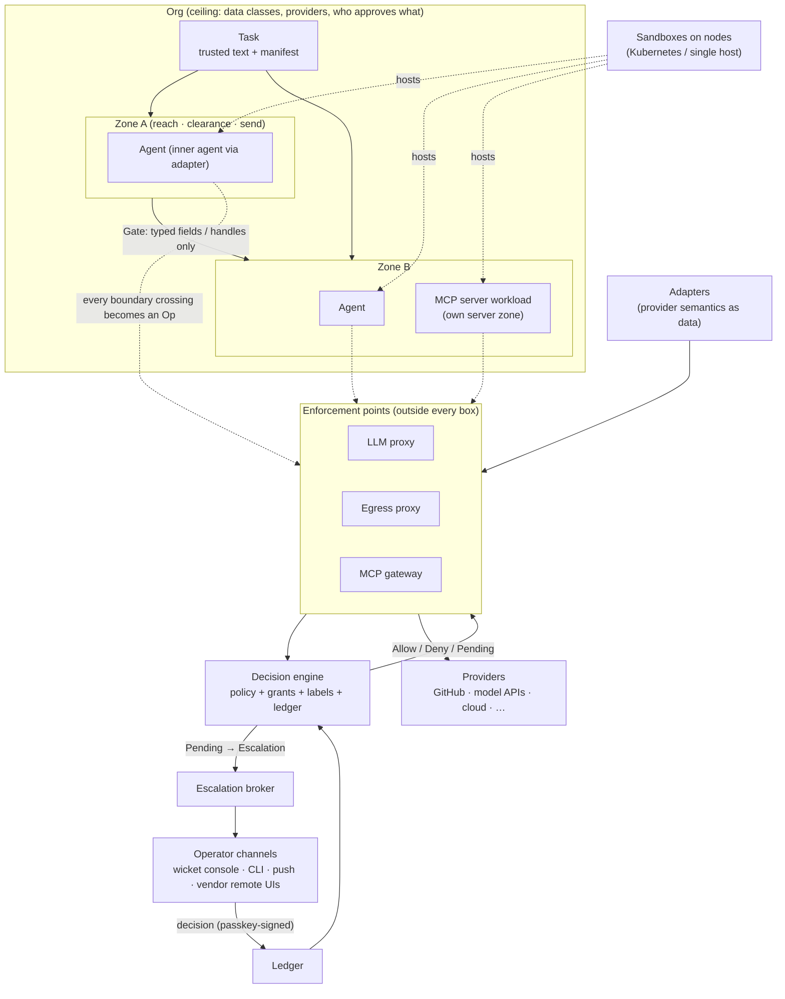

# wicket — core concepts

*High-level design, 2026-11-08. This is the map; [design.md](design.md) is the detailed design, and
[prior-art.md](prior-art.md) plus [research/](research/) hold the evidence behind it.*

## What wicket is

wicket is a **meta-harness**. It does not run an agent loop and it does not care which model is thinking.
It builds the *environment* other agents run in, such as Claude Code, Codex, pi or any process:
- what each agent can reach;
- what it can see;
- where it can send things;
- who has to agree before any of that changes.

Then it shows humans those boundaries in a form they can reason about.

It is not only a developer tool. An agentic SaaS product can run wicket as its platform, with each of its
customers an isolated **tenant**.

Three ideas carry the whole design:

1. **The box is hostile.** Everything inside a sandbox, including the agent and its own safety settings, is
   assumed compromised. All enforcement sits outside, at a few chokepoints wicket controls. There are no
   secrets in the box, ever.
2. **Humans approve zones and gates, not individual permissions.** People reason well about "this group of
   agents can do X, and only Y can cross into that group". They reason badly about lists of permission
   rules.
3. **Authority only narrows, and every widening is a typed, recorded decision.** Agents start with the least
   a task needs. When they need more, they ask in a structured form that a policy, or a human, can judge
   without reading the agent's (possibly attacker-shaped) reasoning.

---

## The concepts at a glance

---

## The concepts

### Boundary objects: what humans approve

**Platform and tenant.** wicket runs either for one team or as a platform under a SaaS product. In platform
mode the hierarchy is platform → tenant → org → task → zone.
- The platform operator sets each tenant's ceiling through its plan, and tenant admins can only narrow
  within it.
- By default tenants share nothing that could carry data or authority: no kernel, snapshot, credential,
  label namespace, handle, MCP server instance or ledger partition.
- Sharing is an explicit exception through a **cross-tenant gate**: a zone gate lifted one level. It needs
  consent from both tenants and platform policy, is time-bounded and revocable, and is recorded in both
  ledgers. It can carry relabelled data, pinned published artifacts (templates, adapters, skills, MCP
  images), service calls, shared zones, delegated grants, or opt-in shared capacity.
- A tenant's end users approve their own agents' escalations inside the SaaS product, through wicket's
  embeddable approval flow.

**Org.** The ceiling within a tenant (or the whole installation, outside platform mode). It defines:
- the **data classes** that exist (`acme.source`, `customer.pii`);
- which providers and destinations are cleared for which classes;
- who may approve what (by risk and data class);
- the money envelope.

Every task's authority is bounded by the org.

**Task.** A unit of work, made of two parts:
- **trusted task text**, written by a human or by a trusted parent. It is the only input policy derivation
  ever sees;
- a **manifest**: the zone/gate graph for the task. An LLM may *propose* the manifest by choosing from
  vetted templates. A solver minimises it, and it must fall between human-approved floors and ceilings.

**Zone.** A set of agents and workloads that share a ceiling and can pass data freely among themselves. A
zone is described by:
- **reach**: what it can act on, as capabilities;
- **clearance**: what data classes it may see;
- **send**: where it may send data;
- **taint admission**: which untrusted sources it may ingest at all, and which taint may be present for
  actions of each risk level;
- an **isolation floor** and **placement rules**;
- an **operator mode**: whether a vendor remote UI may also watch it.

Zones nest, and a child zone's ceiling is always a subset of its parent's. A uniform swarm is one zone. A
mixed swarm is several zones joined by gates.

**Gate.** The *only* place where data or authority crosses between zones. A gate passes:
- **typed, low-capacity fields** (booleans, enums, bounded integers, validated strings);
- **handles**;
- the output of a **quarantined reader** (a capability-less LLM that turns untrusted text into typed
  fields);
- an explicit **declassification** by a named decider;
- or nothing without **human approval**.

Free text never crosses a gate into wider authority. That covers children's status and errors too, which
are a proven hijack path.

### Actors: what runs

**Agent (inner agent).** A black-box process that does the work: Claude Code, the Codex app-server, pi, an
ACP agent, or any program. wicket reaches it through an **adapter**, which:
- knows how to launch the agent with only placeholders and routes (never credentials);
- speaks its control protocol, which is how wicket answers its permission prompts, steers it and reads
  typed output;
- lists the agent's quirks (`AgentCaps`).

Adapters are classified on two axes:
- **Tier**: T1 = native control protocol; T2 = ACP; T3 = plain process.
- **Placement**: the whole agent in the box, or the agent's brain outside with only its "hands" inside.

Nothing an adapter configures inside the box is trusted. Adapter settings are telemetry and politeness.

**Workload.** Anything wicket runs:
- an agent's sandbox;
- a third-party **MCP server** (each in its own sandbox and its own small *server zone*, one instance per
  task, with no credentials and no network of its own);
- a codemode runtime;
- a per-call CLI tool sandbox;
- wicket's own per-node services.

Every workload has an isolation requirement, its own reach, placement rules, a lease and a label.

**Sandbox.** The isolation boundary a workload runs in. It comes from a pluggable backend: a process jail
(development), gVisor (the default floor), microVMs (Firecracker, Kata), macOS Seatbelt, hosted sandboxes,
or Wasm/V8 isolates (tool-only codemode).
- The scheduler picks the **cheapest backend that meets the isolation floor**.
- Startup time and per-instance overhead are budgeted, because boundaries that are expensive get merged
  away.
- Sandboxes are pre-warmed without identity and **bound to a zone only when claimed**.
- Sandboxes can be **parked** (frozen or checkpointed) while a human decides, and restored later.

**Node / cluster / provider.** Where sandboxes live, across clouds.
- **Providers** (Vultr, Hetzner, AWS, GCP, Azure, Fly, hosted sandboxes, or this machine) are plugins.
  Their differences are data wicket reasons about: billing granule, KVM, idempotency, node identity and
  attestation.
- **Kubernetes holds capacity:** node pools, autoscaling and long-lived services, as managed Kubernetes or
  k3s on any cloud's VMs. **`wicket-node`** runs on every node:
  - it launches sandboxes directly on the hot path, because pods are too slow and can't park;
  - it runs that node's enforcement points;
  - it holds short-lived credentials for its own workloads only.
- **A provisioner** is the only holder of cloud credentials. It creates hosts idempotently, snaps leases to
  billing hours and reserves the worst-case cost in the ledger.
- **Agents can ask for capacity, never for cloud keys.**
- **A single-host mode with no Kubernetes** exists for laptops and development.

### The mediation path: how every action is judged

**Enforcement points.** Three chokepoints outside every box. A sandbox's *only* network route leads to
them:
- **LLM proxy.** Holds the model key, enforces model and budget limits, rewrites server-side tools, marks
  taint from server-side results, and senses liveness (an agent that stops calling the model is waiting).
- **Egress proxy.** Terminates TLS with a per-box CA. It canonicalises each request or rejects it, maps it
  through adapters, rebuilds it from the decision, injects the real credential into exactly one declared
  slot, and enforces git rules by store-and-forward.
- **MCP gateway.** Serves tools generated from adapters, relays isolated third-party servers, and serves
  wicket's own `wicket.*` tools (`await_grant`, `request_access`, `spawn`, …).

The same call made two ways (an MCP tool or `gh api`) gets the same decision, because both are translated
into the same thing:

**Op.** The normalised form of every boundary crossing:

  `(agent, provider, verb, resources, effects, risk, declared args, digest)`

The agent's identity comes from the transport it arrived on, never from the request. Arguments are marked
**content** (may be untrusted) or **sink** (recipient, target repo, host, amount: must trace to trusted
text).

**Adapter (provider adapter).** Provider semantics as *data*: which endpoints exist, which resources each
touches, what verb, what side effects (CI runs, notifications, publishing, minting credentials), and so what
**risk class** (R0 read … R4 code execution, privilege or money).
- Unknown means deny; undeclared parameters mean deny.
- A hand-maintained **dangerous-patterns** list can only raise risk.
- Adapters can be generated automatically, but a generated rule only ever starts *narrower* (R4) and is
  lowered only on evidence.

**Capability, grant, policy.** A **capability** is a typed permission: provider, resource pattern, verbs,
maximum risk, constraints on arguments. A **grant** is a capability plus a budget (expiry, uses) held by a
zone or agent. **Policy** is the human-authored layers: org ceiling, zone policy and forbids, in Cedar, so
it can be proven, for example that a child zone ⊆ its parent.

**Decision engine.** One library, in-process in every enforcement point, deciding each `Op`:

  `org ∧ every ancestor zone ∧ a live grant ∧ label rules ∧ ledger`

The answer is **Allow**, **Deny** (with remedies the agent can try) or **Pending** (with a request id).

**Ledger.** The server-side record of authority: grants, use counts, approvals, revocations, policy epochs
and the cumulative-grant "ratchet". Single-use and expiry live here, not in tokens. No token ever enters a
box.

### Information flow: what data is allowed to do

**Label.** Every piece of data, and every agent, carries a label with two parts:
- **confidentiality**: which data classes it contains;
- **integrity**: which untrusted sources touched it (`web`, `repo-content`, `unknown`, …).

An agent's label rises as it reads, capped by its zone. Labels drive three rules:
- **no writing down**: you can't send data, even inside a GET's URL, to a destination not cleared for it;
- **no tainted instructions into wider authority**: risky actions require that the agent's taint is
  allowed for that risk level;
- **sink provenance**: sink arguments must trace to trusted text.

**Handle.** An opaque reference to content: a transcript, a diff, a fetched page, a tool result. Agents can
pass a handle on, to a child, to a tool argument or to the final output, *without reading it*. Reading it
joins its label into the reader. Handles are what stop "everything is tainted by the time it reaches the
root".

**Memory.** Any state that outlives a write: stores, the agent's own config and transcripts, the workdir,
caches, the agent's own policy files, provider-side state (a comment one agent wrote and another reads),
and wicket's own learned artifacts. Memory is task-scoped and labelled by default. Promoting it to
persistent memory is a declassification, made by a named decider.

### Change and oversight: how boundaries move, and who watches

**Escalation.** When an `Op` is outside current grants, the agent gets *pending* with a request id.
- The **typed request** is judged on its fields, never on the agent's justification.
- It is decided by the **auto** tier (inside the zone's ceiling and low risk), then a parent zone (off
  until proven), then a **human**.
- Grants are always narrower than or equal to the ask, and expire at task end at the latest.
- The ratchet catches many small grants adding up.
- Approval fatigue is managed, not trusted: an approval rate of 95% means habituation.

**Operator channel.** Any surface through which humans watch and act:
- **wicket's own**: the console (mobile web app), the CLI, the API and push notifications. These are the
  only surfaces that can *decide* escalations, with a passkey signature bound to the exact request.
- **vendor remote UIs**: Claude Remote Control, Codex Remote Control. These can watch and steer an agent,
  but their approvals only answer the agent's own advisory prompts, never wicket's.

All channels project one event log. Every message carries its **origin**: a typed task amendment from a
wicket operator becomes trusted text; free-text steering, vendor-UI messages and pasted content do not.

**Views.** The zone/gate graph, a blast-radius answer to "if this zone is compromised, what can happen?",
and a timeline of grant changes. All are generated from the live enforcement configuration, never drawn by
hand.

---

## How the concepts relate

| Relationship | Rule |
|---|---|
| Platform ⊇ Tenant ⊇ Org ⊇ Task ⊇ Zone ⊇ child Zone | Ceilings only narrow downward; checked at admission, proven with Cedar's analyser, enforced by evaluating the whole chain |
| Tenant ⟷ Tenant | Nothing crosses by default; sharing only through a cross-tenant gate with consent from both tenants and platform policy |
| Zone ⟷ Zone | Only through a Gate, and the Gate's rule decides what can cross |
| Zone → Agent, Workload | Agents and workloads are members of exactly one zone; MCP servers get their own server zone ⊆ the caller's reach |
| Workload → Sandbox → Node | A workload runs in a sandbox that meets its isolation floor, placed on a node by Kubernetes or the single-host scheduler |
| Agent → Enforcement point | The sandbox's only routes lead there; the transport identifies the agent |
| Enforcement point → Op → Decision engine | Every crossing is normalised by adapters and decided by one engine |
| Decision engine ⟷ Ledger, Policy, Labels | Decisions read grants, policy and labels; allowed reads raise labels |
| Pending → Escalation → Operator channel → Ledger | The only way authority widens; humans decide in wicket's own channels |
| Data → Label → Handle → Gate | Content carries labels; handles let it move without being read; gates decide what may cross |
| Memory → Declassify | State that outlives a task needs a named decider to persist |
| Everything → Views | Humans see what is actually enforced |

## Walkthrough: one task

1. **The owner writes the task text:** "fix the flaky test in acme/api and open a PR". The proposer picks
   templates, and the solver produces a manifest with two zones. `research` can read the repo and one docs
   site, and can send nowhere. `fix` can read the repo, write to `wicket/fix-*` branches and open a PR, and
   admits no web taint. A gate between them passes `{cause: enum, file: validated path, line: int, notes:
   handle}`. The owner approves the zones, once.
2. **wicket claims two warm gVisor sandboxes** and binds each to its zone. Claude Code starts in each one,
   holding only placeholders. Its model calls go through the LLM proxy, and its `git` and `gh` calls go
   through the egress proxy.
3. **`research`** reads a docs page that contains an injection. Its label picks up `web` taint. It returns
   `{cause: race, file: tests/test_sync.py, line: 88, notes: h_17}`. The file is validated against the repo
   tree; `notes` stays a handle.
4. **`fix`** writes a patch and pushes to `wicket/fix-race`: allowed, because the sink (repo, branch)
   traces to the task text. It then tries to edit `.github/workflows/ci.yml`. The dangerous patterns raise
   that to R4, so the push comes back *pending* with request `R-123`. The agent waits; wicket parks its
   sandbox.
5. **The owner gets a push notification.** The console shows the typed request (repo, path, one use, 10
   minutes), the blast-radius change, and the agent's reasoning folded away as untrusted. The owner taps "narrow
   and approve", and the passkey signs the request digest.
6. **The ledger records the grant.** wicket unparks the sandbox, tells the agent "R-123 granted, retry", and
   the push goes through, once.
7. **The PR is opened.** The task ends: the sandboxes are destroyed, task memory is deleted, the grants
   expire. The transcript and diff stay as labelled handles in the audit log.

## Where to go next

- The detailed mechanisms, types and milestones: [design.md](design.md).
- What each idea is borrowed from, and what was rejected: [prior-art.md](prior-art.md) and the study
  notes in [research/](research/).
- The original concept conversation: [00-origin-conversation.md](00-origin-conversation.md).
